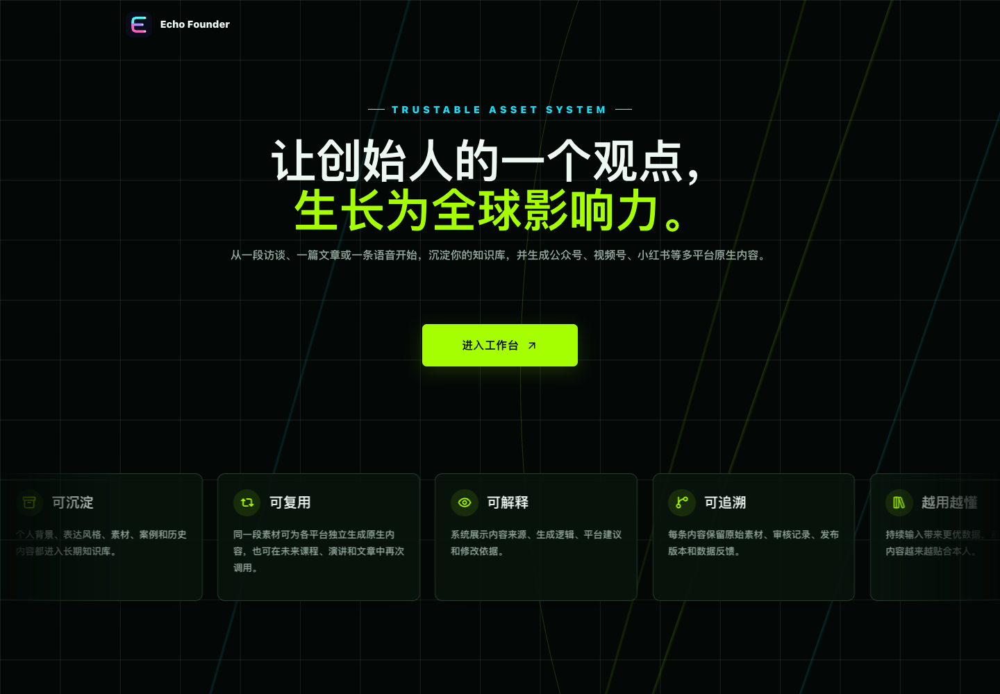
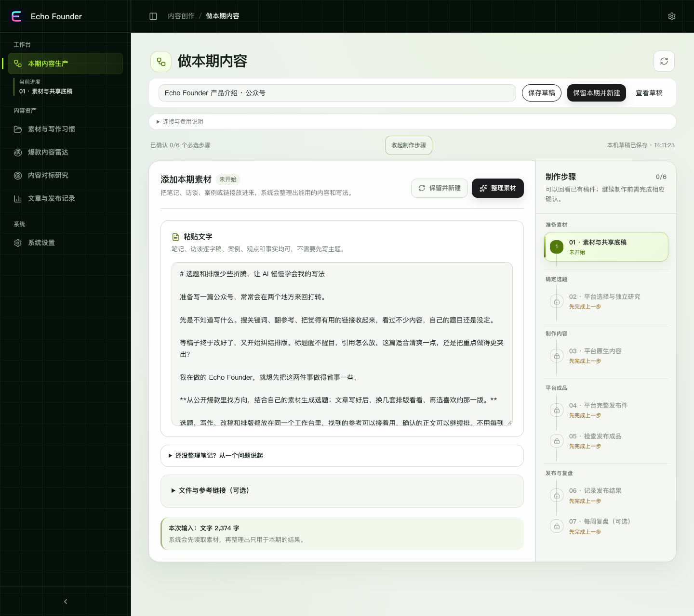

# Echo Founder

一个面向个人创作者、创业者和小团队的 AI 内容创作工作台：从笔记、访谈和已有文章出发，研究选题与对标，写稿改稿，再整理为公众号文章、小红书图文或视频号口播稿。

**当前公开的是 `0.2.0-beta.2` 源码开发版。原创部分采用 [MIT](LICENSE)，随附第三方组件按[各自许可证](OPEN_SOURCE.md)提供；桌面安装包尚未公开发布。**

[下载源码 ZIP](https://github.com/tougheryan/ai-founder-influence-os/archive/refs/heads/main.zip) · [公开范围与第三方授权](OPEN_SOURCE.md) · [安装与配置说明](docs/echo-founder-installation.md) · [项目案例](docs/showcase/case-study.md)



## 可以用来做什么

- **找方向**：通过爆款内容雷达查看公开参考，再结合自己的素材整理候选选题；围绕公开账号做内容对标研究。
- **把内容做出来**：公众号长文、小红书 P1–P8 图文和视频号口播分别组织，支持审阅、局部改稿、版本核对与导出。
- **选择公众号排版**：配置 md2wechat 后调用其主题服务；未配置时使用本仓库独立实现的基础 HTML 排版。
- **积累自己的写法**：保存写作设置，收录实际发布的作品，先查看风格建议，再由作者决定采用哪些规则。



## 从源码启动

当前桌面目标是 macOS 13+、Apple Silicon。开发启动需要 Node.js 22+、npm、Python 3.9+ 和 make；其他平台尚未完成桌面验收。

```bash
git clone https://github.com/tougheryan/ai-founder-influence-os.git
cd ai-founder-influence-os
npm ci --prefix ui
make init PROJECT="$HOME/echo-founder-data"
make ui PROJECT="$HOME/echo-founder-data" PORT=3000
```

打开 `http://127.0.0.1:3000/production`。已有题目时先选“按我的题目写”，只做一个平台也可以；在系统设置中连接自己的模型服务后，再生成方案与文章。生成、研究和外部排版服务可能分别计费。

需要小红书本地卡片渲染时，另行安装：

```bash
npm ci --prefix skills/xhs-card
npx --prefix skills/xhs-card playwright install chromium
```

TikOmni 研究连接器及其服务不随本仓库分发，须使用者自行取得合法使用与部署授权；这不影响按自己的题目和素材写作。可选的 DBS 提示词也不再随公开版打包。

`ui/` 是前端与 Electron 壳，`skills/content-runtime/` 是本地编排与数据契约，`gateway/` 是可选自托管网关。私人项目应放在仓库外；不要提交 API Key、Cookie 或个人素材。源码 ZIP 需要开发环境运行，并非双击安装包。

## 发布状态

本次同步源码与运行说明，保留此前公开展示材料。下载源码、源码检查通过、生成本地预览和完成平台发布分别记录。当前版本没有完成 Apple 签名、公证与独立真实账号商业验收；详情见 [RELEASE.md](RELEASE.md)。

## 开发与运行契约

Echo Founder is a local desktop content-production system for founders. Its operator-facing surface is one workspace: from authorized material to platform-ready drafts and a verified publication record. The active runtime uses the local Codex/Desktop workspace, Python and Node services; it does not require a Superpowers workflow or plugin.

The repository name, environment-variable prefix, CLI compatibility commands and historical `aifios.*` schemas retain `AIFI-OS`/`AIFIOS` as internal engineering identifiers. The customer-facing product, app, DMG, diagnostics and documentation name is **Echo Founder**. Current delivery target: `0.2.0-beta.2`, macOS 13+ on Apple Silicon.

The repository-level [`VERSION`](VERSION) file is the product-version source of truth. Run `make version` to distinguish the current product version, source revision and newest local build; see [the versioning guide](docs/versioning.md) for the rules.

For a concise interview walkthrough, evidence boundaries and the next commercial acceptance priorities, see [the portfolio and commercial convergence guide](docs/echo-founder-portfolio.md).

## Product Boundary

A normal run is one seven-stage path in `/production`, not a menu of individual Skills:

1. Material and fact boundary
2. Platform selection and writing plan, based on verified author material or live platform research
3. Platform-native content review
4. Conditional visual adoption (skipped for Channels-only runs)
5. Selected-platform draft information
6. Per-platform publication result
7. Optional platform review and learning

Stages 2 through 6 stop for the operator's decision. Stage 7 writes reusable learning only after the operator has supplied the required real metrics and confirmed the conclusion. Every artifact, approval, selected visual asset, draft job, publication link and review record belongs to the same local `run_id` and `slug`.

## Platform-Native Delivery

Every new run selects one or more of three primary platforms: WeChat official account, Xiaohongshu and WeChat Channels. The selection is made before preparing the writing source and locks the downstream topic, content, visual, publication and review lanes. Changing platforms requires reconfirming author material or updating the affected research lanes.

- WeChat: one native long-form article with title, summary, body and comment follow-up.
- Xiaohongshu: one native graphic post with a three-line cover, P1-P8 card structure, publishing copy and ending tags.
- WeChat Channels: one native spoken-video execution script with line-by-line copy, shot list, subtitle priorities and publishing copy.

Platforms share source facts, cases, viewpoints, audience and disclosure boundaries. They do not share a mother-draft: each platform uses its own structure, based on the author's confirmed topic and material or that platform's research. Historical five-platform and 1+2+3 runs remain readable, but new runs use the platform-native v2 contract.

## Writing Sources And Research

After reviewing material, choose “按我的题目写” to prepare a plan from your own topic, or “帮我找方向” to research selected platforms. Author mode stores and verifies the current material, topic and platforms, explicitly records that no platform research occurred, and requires human plan approval before writing. It does not require TikOmni. Plan and article generation still need a model connection and may incur provider fees. Missing model settings preserve the local preparation without dispatching a model call.

For an untouched new draft, material analysis prefills one explicit title from pasted author instructions and selects author mode. This only fills the form: the author must still confirm material and the plan before generation. Manual choices, deliberately cleared titles and legacy saved modes are preserved. Material input appears before optional writing prompts; files and links remain expandable. Production steps are collapsed by default and available through “显示制作步骤”, without changing workflow approvals. “保留本期并新建” saves the current draft before closing the draft list and steps; older unfinished content can be resumed from “查看草稿”.

Each writing requirement can be edited on its own. “调整素材分类与全部要求” opens the full correction form when needed. Both use the same version checks: saving a correction preserves source material and old work, and requires the plan and subsequent approvals to be reviewed again. An older editor cannot overwrite a newer saved correction.

The plan review shows the full saved blueprint alongside source material. Chapter edits are previewed and saved as a new version; source bindings and approval records remain protected. Runtime checks compare native platform chapters with verified author or research evidence, blocking missing, extra, duplicate or unknown platform sections at confirmation and downstream writing. “平台范围已核对” means coverage only; factual and editorial review still belongs to the author. Running task status remains visible even when the next workflow stage is locked; viewing or restoring it does not dispatch another model call.

Author mode is an explicit runtime choice, never a fallback for missing or failed research. Both the UI and CLI verify its immutable source record; changed material or platforms require reconfirmation. Existing drafts remain available. Real-provider generation through export remains an acceptance requirement; passing local checks does not establish commercial readiness.

In platform-research mode, topic work begins with a fresh TikOmni research pass for the selected platforms only. Each sample is classified as a verified hit, potential hit or merely related. Missing public metrics remain unknown rather than being displayed as zero, and each platform uses its own ranking thresholds.

A failed platform lane does not erase successful lanes. The run is fully blocked only when none of the selected platforms has usable, attributable evidence; otherwise the operator can continue the successful lanes and retry or remove the failed one. Historical samples, local caches and model inference are never presented as fresh TikOmni evidence.

The resulting research snapshot is bound to the current run and frozen when the operator approves the topic and template. Downstream writing verifies that frozen snapshot rather than silently using a later or different research result.

## Visuals, Drafts And Sending

New runs use stable local layout. WeChat receives complete article HTML with existing authorized images retained from the draft; a newly generated header image or inline illustrations are not required or promised. Xiaohongshu receives the P1–P8 graphic-card set rendered locally. AI image generation is disabled. WeChat Channels receives no generated visual assets, so a Channels-only run skips the visual stage.

After the platform-draft approval, the local queue can fill authorized editors: WeChat uses its official draft API first and an authorized browser only as a fallback; Xiaohongshu and Moments use their authorized local editor paths. The queue never presses public send. The operator sends each item in the platform, then checks it off and stores a real link or verifiable reference. Failed items remain retryable without cancelling the other platforms.

## Weekly Learning And Benchmark Advisor

Weekly review is optional and never blocks a new run. It reminds the operator to enter the key metrics for already published items, then creates a review only from those local, attributable inputs. Long-term learning is written only after a separate human confirmation.

The optional Benchmark Growth Advisor is a project-isolated conversational advisor. It keeps a separate research archive for one to five manually specified public accounts, refreshes its TikOmni evidence weekly, shows horizontal comparisons with links and capture times, and proposes ranked actions. An action changes a production run only when the operator explicitly adopts it.

## Slim Skill Surface

Operators do not navigate Skills during normal production. [`skills/manifest.json`](skills/manifest.json) exposes only a core production tier and a small optional enhancement tier; retired folders remain compatibility input for history migration, not default routing or navigation. See [the active skill catalog](docs/skills-catalog.md) for the exact list.

`docs/superpowers/` is historical planning material only. It is not an active runtime dependency. The current acceptance baseline is [docs/content-production-remediation.md](docs/content-production-remediation.md).

## Quick Start

For a first article, select one platform and choose “按我的题目写” if you already have a topic. Save and test a model connection before generating a plan or article; author mode does not require TikOmni. Configure TikOmni only for “帮我找方向” or optional account research. Public-account GHID is optional for targeted account tracking, not required for keyword research. Keep credentials outside the repository. Saving does not call the model; the connection test sends a short request that may incur a fee. A successful test does not establish sufficient quota or article quality.

```bash
git clone https://github.com/tougheryan/ai-founder-influence-os.git AIFI-OS
cd AIFI-OS
npm ci --prefix skills/xhs-card
make test
make doctor

make init PROJECT=~/ai-content-system
make onboard \
  PROJECT=~/ai-content-system \
  PLATFORMS="公众号" \
  OFFER="内容诊断" \
  TARGET="服务型创始人" \
  PRODUCT="内容获客服务"

make ui PROJECT=~/ai-content-system PORT=3000
```

Open `http://127.0.0.1:3000/production?stage=1`, add material, and follow the selected writing path. The workbench creates the run; a separate `run-create` command is not required for this UI flow. Unselected platforms do not block the first article. Platform authorization is needed only when using the app to fill an external draft; manual handling of the local deliverable remains available. See [QUICKSTART-10MIN.md](QUICKSTART-10MIN.md) for the operator path and [the production loop](docs/content-production-loop.md) for gates, exceptions and evidence rules. Source checks do not replace acceptance of the actual customer installer with real accounts.

## Verification

```bash
make version-check
git diff --check
make test
make runtime-contracts
make ui-runtime-gates
make content-loop-check
cd ui && npx tsc --noEmit && npm run lint && npm run build
```

Runtime unit tests disable external md2wechat calls by default; tests use local fakes or the bundled fallback. The installed-CLI test requires explicit `ECHO_LIVE_MD2WECHAT_TEST=1` and should be selected individually for real-account acceptance, because the layout API may charge its separately configured account. Offline checks do not establish provider availability, actual theme quality or cost.

Use [RELEASE.md](RELEASE.md) for release checks and [the commercial delivery SOP](docs/commercial-delivery-sop.md) for client-facing operations.

For the beta installer and customer handoff, use [the Echo Founder installation guide](docs/echo-founder-installation.md), [API and platform setup](docs/echo-founder-api-platform-setup.md), [backup and upgrade guide](docs/echo-founder-backup-upgrade.md), and [the commercial readiness matrix](quality/commercial-readiness-matrix.md).
