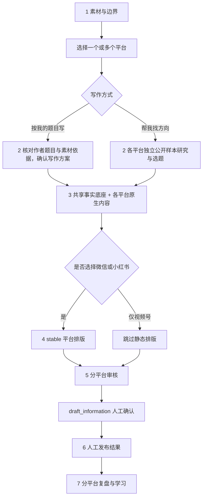

# Echo Founder 内容生产闭环

版本：v3.0

适用平台：微信公众号、小红书、视频号。

运行时真源：`skills/content-runtime/config/production-loop.json`、`content_runtime.py`、`content_pipeline.py`。本流程不依赖 Superpowers；`docs/superpowers/` 仅为历史归档。

## 1. 这套系统解决什么

Echo Founder 把一条已授权的真实素材转成一个或多个平台的原生内容。用户可在微信公众号、小红书、视频号中选择任意非空子集；系统只研究、生产、审核和交付已选平台。

三个平台只共享事实底座：人物、案例、证据、商业目标、隐私和不可公开边界。标题、开头、结构、话术、视觉与发布字段都按平台独立生成。新任务不存在“先写公众号母稿，再拆成小红书和口播稿”的固定关系。

系统默认不自动公开发布，不生成视频成片，也不把第三方相关样本、模拟指标或未经确认的推断写成事实。

## 2. 三种执行方式

| 模式 | 系统负责 | 人负责 |
|---|---|---|
| 自动执行 | 建立 run、保存平台选择、传递上游、生成候选、校验结构、记录状态。 | 处理明确阻断。 |
| 半自动协作 | 理解素材、研究公开样本、生成各平台原生内容和平台排版。 | 确认素材边界、平台选择、内容和完整发布件。 |
| 人工必须 | 准备发布草稿、保存发布结果和复盘待办。 | 在平台内发送、处理验证码/风控、确认真实链接与指标。 |

模型输出不是审批。主题、内容、平台排版和发布结果都要绑定当前 run 与文件摘要的人工确认。

## 3. 全链路图



默认调度：

```text
editorial_core:
  intake -> validate -> blueprint -> package

author_material（明确选择并核验作者素材依据）:
  intake -> author-source-select -> blueprint -> package

draft_preparation:
  visual(stable，条件执行) -> prelaunch -> compliance -> audit
```

`publication_result` 由真人发布事件触发；`weekly_learning` 按周运行。两者都不进入默认内容生产队列。

## 4. 开始前：建档、平台选择与 Run

创建新 run 时必须明确选择至少一个平台：

```bash
make init PROJECT=~/ai-content-system
make run-create PROJECT=~/ai-content-system TOPIC="主题" PLATFORMS="公众号,小红书"
```

平台选择在确认写作依据前锁定。研究模式新增平台必须补做该平台研究；作者模式变更平台需重新确认作者素材依据。取消平台不得删除历史证据。旧任务中的抖音、朋友圈和母稿文件只读兼容，不进入 v2 新任务。

## 5. 核心生产步骤

### 5.1 阶段 1：素材与边界

`intake` 提取人物、场景、观点、案例、事实来源、隐私项、商业目标和素材缺口。H1 由操作者确认授权范围、匿名化方式和模型不能补写的事实。

### 5.2 阶段 2：题目与写作方案

**作者素材模式**：用户在素材页选择“按我的题目写”，填写题目并核对素材。持久任务保存底稿、不可变作者素材记录及排版选择，再生成方案。作者记录绑定本期 run、输入、整理结果、修正版本、底稿、题目和平台，明确未进行平台研究。方案与正文不要求 market-signal 或 validate，但必须通过作者依据核验及 H2 人工确认。研究缺失不会自动启用作者模式。

`content_pipeline.py next/flow/status` 按同一运行时模式处理；作者依据失效时要求重新核对，不调用平台研究。旧方案不匹配当前依据时重新准备方案，旧稿保留；方案更新后的正文不能被当成已同步。默认调度仍停在草稿信息确认，不自动发布。

运维接口 `author-source-context --run-id` 返回当前可核对版本；`author-source-select --content @文件` 接收 `run_id`、唯一 `author_` 加32位十六进制编号、`topic` 及 context 返回的 `intake_path/intake_sha256/material_sha256/source_revision`。仅在作者核对后提交，重试使用同一请求。`author-source-verify --run-id` 可加 `--file` 核验方案绑定。界面负责整理上下文，CLI 不凭空创建素材或模拟研究。

首次 `content-flow` 可用 `INTAKE=文件` 导入；继续时用 `make -C skills/content-runtime content-flow PROJECT=项目 SLUG=本期`，不重复导入以免替换已确认底稿。生成方案和正文需要模型服务，本地来源核验不调用模型或数据服务。

**平台研究模式**：

`market-signal` 只查询已选平台。每个平台单独保存公开链接、样本等级、可得指标和失败原因：

- “已验证爆款”必须有平台适用的可核验表现证据。
- “高潜样本”有较强信号但证据尚不完整。
- “相关参考”只能帮助理解主题，不能展示为爆款。
- 阅读、点赞、收藏、评论等指标缺失时必须显示“未知”，不能写成 `0`。
- 平台失败互不连坐：成功 lane 可以继续；失败 lane 可重试或由用户取消。只有所有已选平台都样本不足时，整期研究才阻断。任何平台都不能借用另一平台样本通关。

`validate` 做立项判断；`blueprint` 输出共享事实底座和每个已选平台的独立选题、结构、评论承接与风险边界。H2 确认平台选择和各平台内容方案。

### 5.3 阶段 3：平台原生内容

`package` 只生成本期已选平台：

- 微信公众号：一篇完整长文，含标题、摘要、正文、引用、评论引导和视觉语义。
- 小红书：一篇独立图文，含封面三句话、P1-P8 逐页卡片文案、发布正文和结尾标签。
- 视频号：一条独立口播执行稿，含 3 秒钩子、逐句稿、镜头/B-roll、字幕重点和发布文案。

H3 逐平台确认。未选平台不得出现在新 package；任一平台缺项只回到该平台生产 lane。

### 5.4 阶段 4：平台完整发布件

平台发布件保留两个交付面：

- 微信公众号：固定使用 `stable` 模式，保留原稿中已有的授权图片，优先由本机 `md2wechat` 生成完整、可复制的微信兼容 HTML；CLI 不可用或调用失败时自动回退到内置 `dbs-wechat-html`。系统不强制生成后台封面或正文插图。
- 小红书：固定使用本地 HTML/SVG 渲染器，把独立内容生成 P1-P8 八张 3:4 观点图文卡片。

新任务不提供 AI 生图选项，不读取生图账户，也不调用付费图片生成服务。系统只给出一套推荐发布件，H4 按平台整套确认；排版修改生成新 revision，不要求比较视觉方向。仅选择视频号时自动跳过，不生成封面、图卡或 MP4。选择多个图文平台时，微信与小红书分别生成、分别验收，不共享模板或文件。

### 5.5 阶段 5：分平台审核与草稿确认

`prelaunch`、`compliance`、`audit` 分平台检查事实、隐私、版权、自然表达、商业闭环和平台规则。通过后只建立已选平台的草稿任务，并停在 `draft_information` 等待 H5。

### 5.6 阶段 6：发布结果

系统准备草稿，不替代账号主体点击发送。操作者发布后逐平台记录真实 URL、时间或受控本地凭证。单个平台失败留在自己的重试队列，不撤销其他平台结果。H6 确认真实发布完成。

### 5.7 阶段 7：每周复盘

`performance`、`review`、`archive`、`twin` 按 `run_id + slug + platform` 聚合。H7 确认缺失指标和可进入长期学习的结论；没有真实发布证据时不得伪造复盘数据。

## 6. 可选支线：什么时候才需要

| 支线 | 何时使用 | 回到哪里 |
|---|---|---|
| `angle -> breakdown` | 需要比较同一平台内的角度、标题或钩子。 | `blueprint` |
| `dbs-fusion` | 商业目标、产品表达或转化承接不清楚。 | `blueprint` |
| `wechat-writer` / `content-repurpose` | 用户明确要求处理一篇已有旧稿。 | 单次人工改编，不进入新任务默认链路。 |

可选动作只有在操作者明确采用后才影响当前 run。

## 7. 必须遵守的人工控制点

| 关口 | 人确认什么 | 系统不得绕过什么 |
|---|---|---|
| H1 素材边界 | 授权、隐私、事实边界。 | 未确认信息不能写成公开事实。 |
| H2 平台与选题 | 平台选择、各平台样本等级、主题与内容方案。 | 未选平台和无证据 lane 不能进入生产。 |
| H3 原生内容 | 每个平台的标题、正文、承诺和风险。 | 不允许用公众号母稿替代其他平台成稿。 |
| H4 平台排版 | 微信完整 HTML 和/或小红书 P1-P8。 | 视频号不得被排版步骤阻断。 |
| H5 草稿信息 | 文案、图片、顺序和目标平台。 | 默认流程必须停在 `draft_information`。 |
| H6 发布结果 | 平台内真人发送及真实凭证。 | 系统不能伪造已发布。 |
| H7 周度学习 | 真实指标与可复用结论。 | 未确认数据不能写入长期学习。 |

## 8. 异常处理与回流规则

| 问题 | 禁止做法 | 正确回流 |
|---|---|---|
| 素材不完整 | 用常识补写事实。 | 回 `intake` 补一手材料。 |
| 某平台无可用样本 | 用另一平台样本或把相关内容叫爆款。 | 只阻断该 lane，重试或取消该平台。 |
| 所有已选平台研究失败 | 进入写作模式硬生成。 | 修复凭据、接口或检索词后重跑。 |
| 平台成稿缺项 | 补产未选平台或用其他平台成稿替代。 | 只修复对应平台 package 段落。 |
| 微信/小红书排版失败 | 用提示词或建议书冒充成品。 | 只修复对应排版 lane 并生成真实文件。 |
| 草稿填充失败 | 取消其他平台或盲目重试。 | 保存独立失败状态，其他平台继续。 |
| 发布后缺数据 | 用 `0` 或模拟值补齐。 | 保持未知，等待真实数据回填。 |

## 9. 每轮最小操作清单

1. 创建 run，选择平台，导入素材并完成 H1。
2. 分平台获取公开样本，确认样本等级与选题，完成 H2。
3. 逐平台检查原生成稿，完成 H3。
4. 如选择微信或小红书，确认对应完整排版发布件；视频号单选自动跳过，完成 H4。
5. 检查已选平台草稿并完成 H5；默认生产在此暂停。
6. 真人发送后逐平台记录发布结果，完成 H6。
7. 按周补齐可得指标并确认学习，完成 H7。

## 10. 运行健康检查

```bash
make version-check
make content-loop-check
make runtime-contracts
make test
cd ui && npx tsc --noEmit && npm run test:unit && npm run test:copy
```

这些自动化门禁校验流程和数据契约，不能替代 TikOmni 真实凭据、平台账号、真人发布和真实表现验收。

闭环是：`真实素材 -> 平台选择 -> 分平台研究 -> 分平台原生内容 -> stable 平台排版 -> 分平台草稿 -> 真人发布 -> 分平台学习`。
